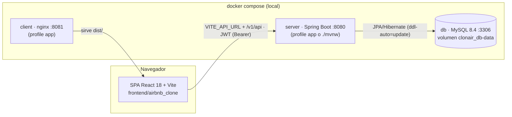
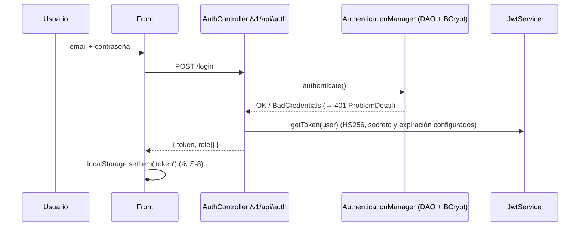
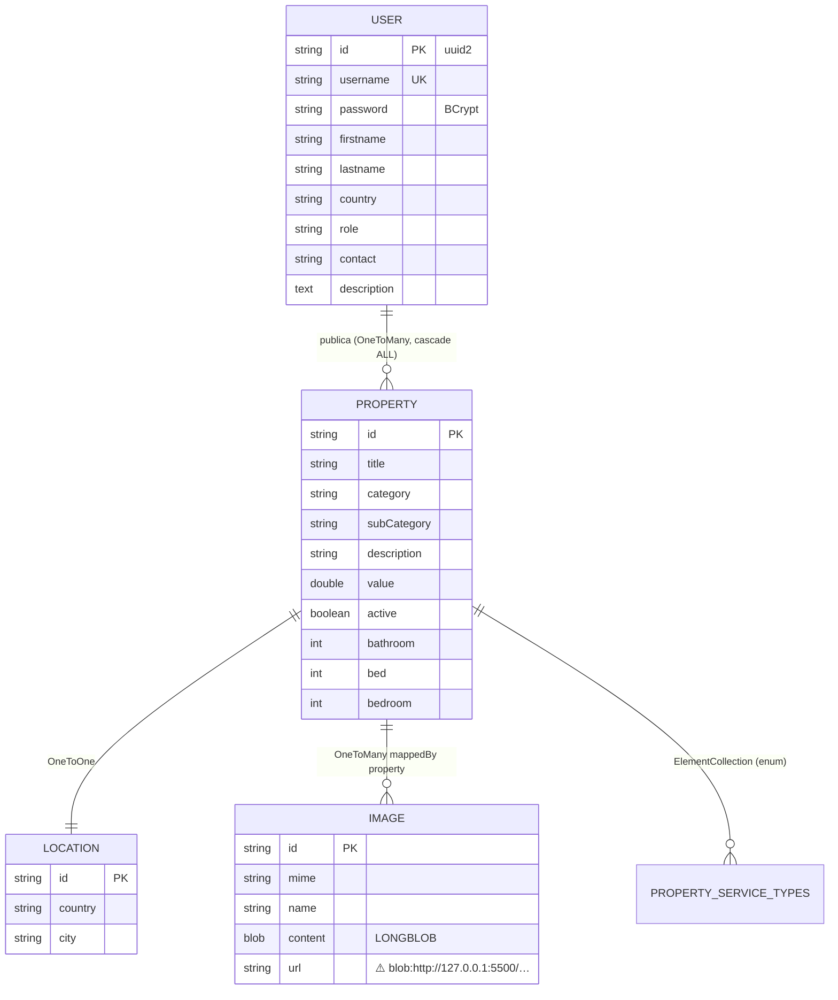

# Arquitectura

Actualizado para T-008 (2026-10-12). Lo que está roto se marca ⚠️ con su tarea.

## Componentes



## Flujo de un request

```mermaid
sequenceDiagram
  participant F as Front (apiRequests.jsx)
  participant J as JwtAuthenticationFilter
  participant C as Controller
  participant S as Service (*ServiceImp)
  participant R as Repository (Spring Data)
  participant D as MySQL
  F->>J: GET /v1/api/property (público, sin token)
  opt Si viene un Bearer token
    J->>J: valida firma/expiración, carga UserDetails
  end
  J->>C: continúa (GET público)
  C->>S: getAll()
  S->>R: findAll()
  R->>D: SELECT …
  D-->>R: filas
  S-->>C: List<PropertyResponse> (record)
  C-->>F: 200 JSON
  Note over C,F: Errores MVC y dominio → GlobalExceptionHandler → status + ProblemDetail
  Note over J,F: JWT inválido / falta autenticación → 401; permiso insuficiente → 403
```

## Autenticación



- Stateless (`SessionCreationPolicy.STATELESS`), CSRF deshabilitado. Públicos: `/v1/api/auth/*`, `/swagger-ui/**`, `/v3/api-docs/**`, GET de catálogo/imágenes, `/error` y `GET /actuator/health`.
- Roles `USER`, `OWNER`, `ADMIN` (`Role.java`) como authorities **sin prefijo** `ROLE_`. `SecurityConfig` restringe listado y borrado de usuarios a ADMIN; el chequeo OWNER/dueño permanece en `PropertyServiceImp`.

## Modelo de datos



Sin migraciones: Hibernate crea/actualiza el esquema. No existe entidad de reservas.

## Endpoints principales

Prefijo `/v1/api`. Contrato vivo: http://localhost:8080/v3/api-docs (Swagger UI en `/swagger-ui`).

| Endpoint | Pantalla (front) | Estado |
|---|---|---|
| `POST auth/register`, `POST auth/login` | `components/forms/Forms.jsx` | Registro 201 + token; login 200 + token/role. Registro público solo USER/OWNER; ADMIN se asigna por base/seed. |
| `GET property` | Home `shared/CardContainer` y filtros | Público (sin token) |
| `GET property/{id}` | `cards/DetailContainerCard` | Público (sin token) |
| `GET property/user/{id}` | `owner/PropertiesUser`, `admin/AdminPanel` | Público (sin token) |
| `POST property` (multipart) | `property/PropertyRegister` | 201 sin cuerpo; OWNER |
| `PUT property/{id}` (multipart) | `owner/PropertiesUpdateForm` | |
| `DELETE property/{id}` | `owner/PropertiesUser`, `admin/AdminPanel` | 204 sin cuerpo; solo dueño |
| `GET user` | `admin/AdminPanel` | Solo ADMIN (`hasAuthority`, sin prefijo `ROLE_`) |
| `GET user/{id}`, `GET user/username/{u}` | `user/PersonalInfoForm`, `admin/AdminPanel` | Requiere autenticación |
| `PUT user/{id}` | `user/PersonalInfoForm` | ⚠️ comentado en el back (Backlog P2) |
| `DELETE user/{id}` | `admin/AdminPanel` | 204 sin cuerpo; solo ADMIN |
| `GET img/{id}`, `GET img/{id}/url` | `` en cards | Público. ⚠️ contrato de URLs pendiente (T-012) |
| `POST/PUT/DELETE img…` | carga/edición de imágenes | Requiere autenticación |
| — (reservas) | `cards/DetailCardReservation`, `user/TripsUser` | ⚠️ no existe (Backlog P2) |

Los GET de propiedades e imágenes son públicos; las escrituras requieren autenticación y conservan las reglas de servicio existentes. El antiguo permiso `/v1/api/render/*` se quitó. CORS permite solo los orígenes configurados en `CORS_ALLOWED_ORIGINS` y procesa preflight antes de autenticar. Los errores de rol de registro son 400 y username duplicado 409.

## Errores y health

`GlobalExceptionHandler` extiende `ResponseEntityExceptionHandler` para conservar los códigos MVC (JSON inválido 400, método 405, media type 415) y mapear excepciones de dominio a 400/403/404/409. Seguridad usa `SecurityProblemHandler` tanto en `AuthenticationEntryPoint`/`AccessDeniedHandler` como en el filtro JWT. Credenciales malas y usuario desconocido devuelven el mismo 401 y challenge `WWW-Authenticate: Bearer`. Un Bearer inválido produce 401 también en rutas públicas; no se cambia su acceso anónimo.

Cuerpo: `application/problem+json` con `type`, `title`, `status`, `detail`, `instance`. Errores internos → 500 genérico; no se envían SQL, excepciones ni stack traces. `/error` está permitido y `ProblemErrorController` mantiene ese contrato para el despacho del contenedor.

Actuator expone únicamente `health` por HTTP/JMX; `/actuator/health` es público, devuelve solo `status` y verifica MySQL. Compose y `scripts/dev.sh` esperan ese endpoint. El front usa `response.ok`: registro 201 y deletes 204 conservan su compatibilidad. `updateUserData` invalida el token ante 401; 403 conserva la sesión y representa falta de permiso. Las URLs de imágenes siguen pendientes de T-012.

## Arquitectura objetivo

- Tests con la misma DB que producción vía Testcontainers → [ADR 0001](adr/0001-testcontainers-mysql.md).
- Migración por escalones protegida por tests (Boot 3.2 → 3.5 → 4.x, Java 17 → 21/25, Vite/React/Router por separado) → [ADR 0002](adr/0002-migration-path.md).
- Se mantiene JWT stateless, con secreto y expiración por configuración, reglas por rol en `SecurityConfig` y errores `ProblemDetail` → [ADR 0003](adr/0003-jwt-stateless-auth.md).
- Se mantienen las carpetas `backend/` y `frontend/airbnb_clone/` → [ADR 0004](adr/0004-keep-folder-layout.md).
- A futuro (P2): DTOs en todas las respuestas, Flyway, imágenes fuera de la DB, paginación.
