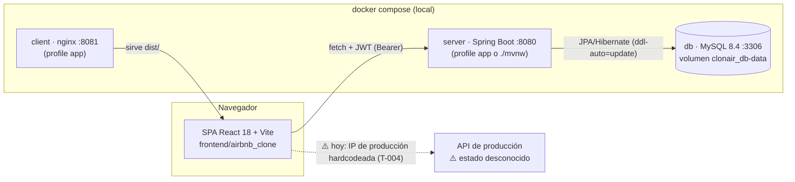
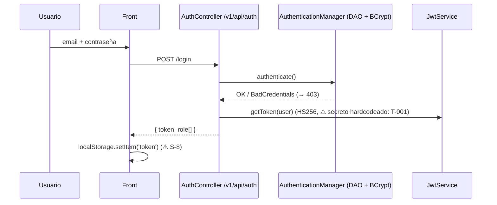
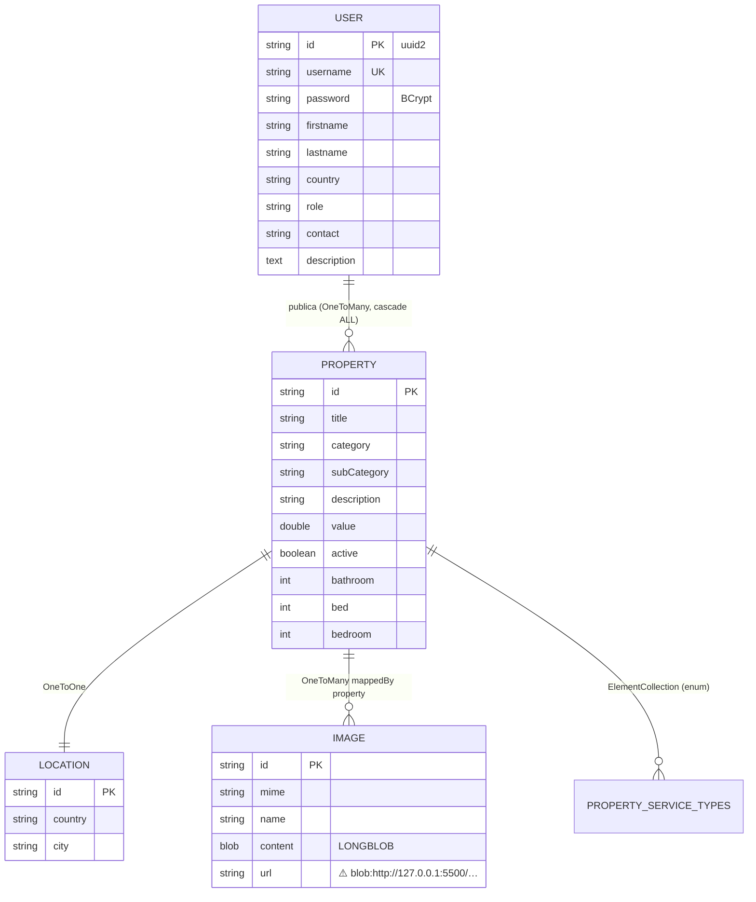

# Arquitectura

Estado real al 2026-10-10 (auditoría inicial). Lo que está roto se marca ⚠️ con su tarea.

## Componentes



## Flujo de un request

```mermaid
sequenceDiagram
  participant F as Front (apiRequests.jsx)
  participant J as JwtAuthenticationFilter
  participant C as Controller
  participant S as Service (*ServiceImp)
  participant R as Repository (Spring Data)
  participant D as MySQL
  F->>J: GET /v1/api/property (Authorization: Bearer …)
  J->>J: valida firma/expiración, carga UserDetails
  J->>C: SecurityContext autenticado
  C->>S: getAll()
  S->>R: findAll()
  R->>D: SELECT …
  D-->>R: filas
  S-->>C: List<PropertyResponse> (record)
  C-->>F: 200 JSON
  Note over C,F: ⚠️ cualquier excepción → 403 (sin @RestControllerAdvice; /error no es público) → T-008
```

## Autenticación



- Stateless (`SessionCreationPolicy.STATELESS`), CSRF deshabilitado. Públicos: `/v1/api/auth/*`, `/swagger-ui/**`, `/v3/api-docs/**` (`SecurityConfig.java:47-55`).
- Roles `USER`, `OWNER`, `ADMIN` (`Role.java`) como authorities **sin prefijo** `ROLE_`. No hay reglas por rol en `SecurityConfig`: el chequeo OWNER está a mano en `PropertyServiceImp` (⚠️ T-003).

## Modelo de datos



Sin migraciones: Hibernate crea/actualiza el esquema. No existe entidad de reservas.

## Endpoints principales

Prefijo `/v1/api`. Contrato vivo: http://localhost:8080/v3/api-docs (Swagger UI en `/swagger-ui`).

| Endpoint | Pantalla (front) | Estado |
|---|---|---|
| `POST auth/register`, `POST auth/login` | `components/forms/Forms.jsx` | ⚠️ el front llama a `/auth/*` (T-004) |
| `GET property` | Home `shared/CardContainer` y filtros | ⚠️ requiere token; la home es pública (T-003) |
| `GET property/{id}` | `cards/DetailContainerCard` | ⚠️ idem |
| `GET property/user/{id}` | `owner/PropertiesUser`, `admin/AdminPanel` | |
| `POST property` (multipart) | `property/PropertyRegister` | ✅ verificado por curl |
| `PUT property/{id}` (multipart) | `owner/PropertiesUpdateForm` | |
| `DELETE property` | `owner/PropertiesUser`, `admin/AdminPanel` | ⚠️ falta `{id}` (T-006) |
| `GET user`, `GET user/{id}`, `GET user/username/{u}` | `admin/AdminPanel`, `user/PersonalInfoForm` | ⚠️ cualquier usuario lista todos (T-003) |
| `PUT user/{id}` | `user/PersonalInfoForm` | ⚠️ comentado en el back (Backlog P2) |
| `DELETE user/{id}` | `admin/AdminPanel` | ⚠️ cualquier usuario borra a cualquiera (T-003) |
| `GET/POST/PUT/DELETE img…` | `` en cards | ⚠️ requiere token y URLs inválidas (T-012) |
| — (reservas) | `cards/DetailCardReservation`, `user/TripsUser` | ⚠️ no existe (Backlog P2) |

## Arquitectura objetivo

- Tests con la misma DB que producción vía Testcontainers → [ADR 0001](adr/0001-testcontainers-mysql.md).
- Migración por escalones protegida por tests (Boot 3.2 → 3.5 → 4.x, Java 17 → 21/25, Vite/React/Router por separado) → [ADR 0002](adr/0002-migration-path.md).
- Se mantiene JWT stateless, con secreto y expiración por configuración, reglas por rol en `SecurityConfig` y errores `ProblemDetail` → [ADR 0003](adr/0003-jwt-stateless-auth.md).
- Se mantienen las carpetas `backend/` y `frontend/airbnb_clone/` → [ADR 0004](adr/0004-keep-folder-layout.md).
- A futuro (P2): DTOs en todas las respuestas, Flyway, imágenes fuera de la DB, paginación.
